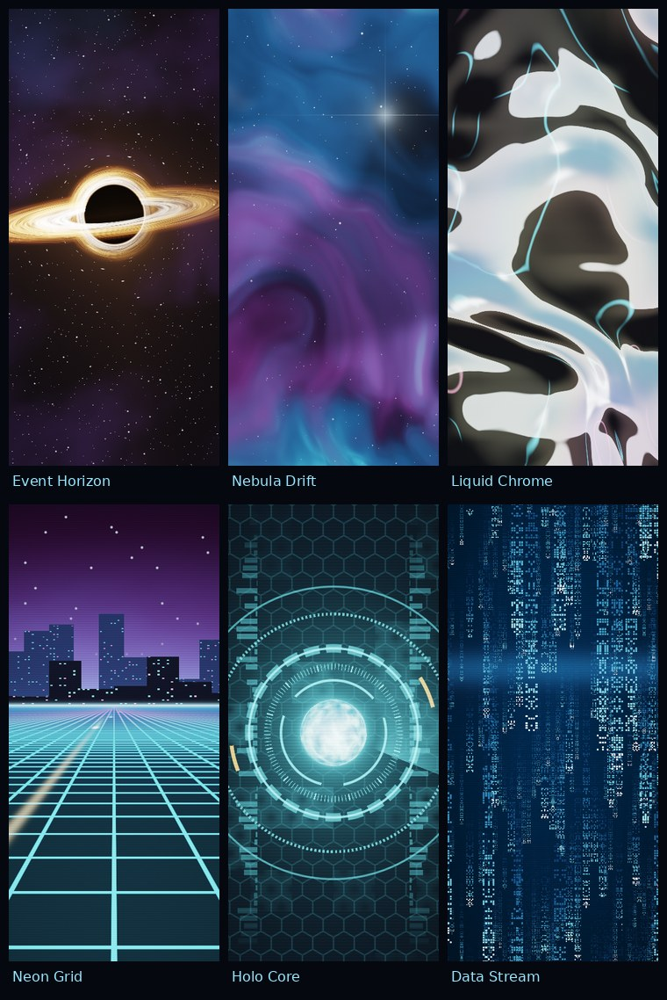
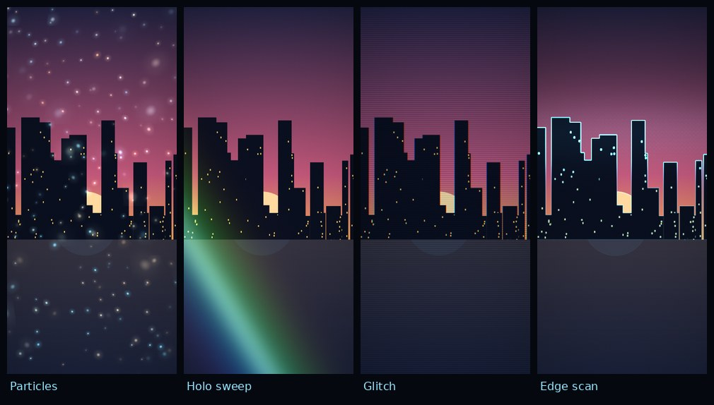

# Akini

Hi-tech live wallpapers for Android, plus a mode that animates your own photos.
Open source. **No ads, no trackers, no permissions, and no internet access.**



## Features

- **Six built-in live scenes**, rendered in real time on the GPU:
  Event Horizon, Nebula Drift, Liquid Chrome, Neon Grid, Holo Core, Data Stream.
- **My Photo**: pick any picture and Akini animates it.
  - Motion: Still, Drift (slow cinematic pan and zoom), Tilt (moves as you tilt the phone)
  - Effects: Particles, Holo sweep, Glitch, Edge scan
- **Tilt parallax**: scenes shift with the phone's motion sensor.
- **Touch ripple**: tap the home screen to send out a glowing shockwave.
- **Battery-friendly**: pauses whenever the wallpaper isn't visible. Frame rate (24/30/60) and render quality are adjustable.
- Works on the **home screen and the lock screen**.



## Install

1. On your phone, open the [latest release](../../releases/latest) and download **Akini.apk**.
2. Open the file. If Android asks, allow your browser or file manager to **install unknown apps**.
3. Open Akini, pick a scene, then tap **SET AS WALLPAPER**.
4. On the preview screen, tap **Set wallpaper** and choose **Home and lock screens**.

Changing scenes or settings in the app afterwards updates the wallpaper instantly. There's no need to apply it again.

## Privacy

The app declares no permissions at all. Without the internet permission, it physically cannot load ads or send data anywhere.
Photos are picked with the system photo picker, and a downscaled copy is stored privately inside the app.

## How it's built

- Kotlin, using only Android framework APIs. No third-party libraries.
- Scenes are GLSL ES 1.00 fragment shaders in `app/src/main/assets/shaders/`. They share helpers from `common.glsl`.
- `AkiniWallpaperService` hosts a `GLSurfaceView` on the wallpaper surface. `SceneRenderer` draws the selected
  scene, optionally at reduced resolution through an offscreen buffer.
- Every push to `main` builds a signed release APK with GitHub Actions and publishes it as a GitHub release.

### Build locally

```
./gradlew assembleRelease
```

Requires JDK 17 and the Android SDK (API 35).

### Adding a scene

1. Add `your_scene.frag` to `app/src/main/assets/shaders/`. Uniforms available: `uRes`, `uTime`, `uTilt`, `uTouch`. End with `gl_FragColor = vec4(finish(tonemap(col)), 1.0);`.
2. Add a `Scene("your_scene", "Title", "Tagline")` entry in `Scenes.kt`.

## Signing

Release APKs are signed with the key in `signing/`. Its password is public, so anyone can build an APK that installs as an update to yours.
For personal use that's fine, as long as you only install APKs from your own Releases page.
To use a private key instead, add these repository secrets: `AKINI_KEYSTORE_BASE64` (the keystore, base64 encoded), `AKINI_KEYSTORE_PASSWORD`, `AKINI_KEY_ALIAS`, `AKINI_KEY_PASSWORD`.
Switching keys means uninstalling the old version once.

## License

MIT
